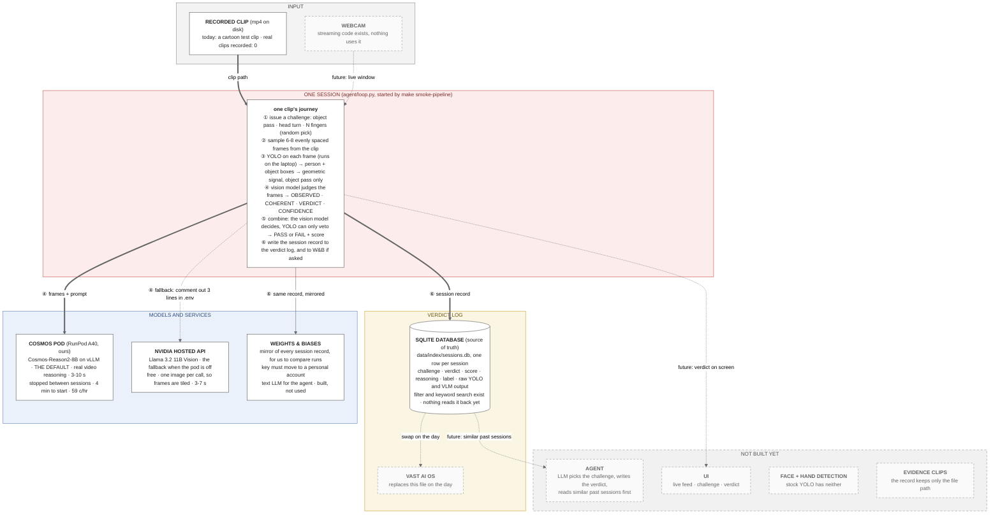
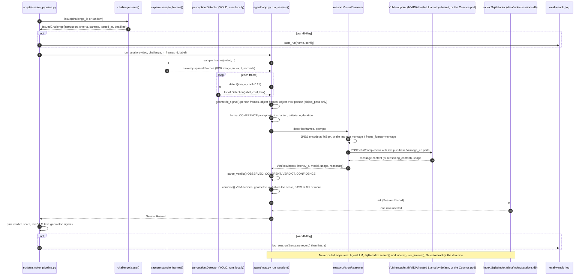

# Architecture (as of Sun 11 Oct 2026)

GitHub renders these inline. To edit one, paste the matching `.mmd` file into https://mermaid.live.

## Where it is going: the target workflow

```mermaid
%%{init: {"theme": "neutral", "themeVariables": {"fontFamily": "IBM Plex Mono, Menlo, monospace", "fontSize": "13px"}, "flowchart": {"nodeSpacing": 30, "rankSpacing": 60, "curve": "basis"}}}%%
%% liveness-agent: the target workflow, fully built. Paste the whole file into https://mermaid.live
flowchart LR

subgraph TRIG["Where it starts: the finance workflow"]
  REQ["<b><u>High-stakes request</u></b><br/>on a video call: new payee,<br/>large transfer, credential reset"]
  POL["<b><u>Policy gate</u></b><br/>does this action need a<br/>liveness check? by amount,<br/>payee novelty, caller role"]
  REQ --> POL
end

subgraph SETUP["Session setup: the agent (LLM on W#38;B)"]
  CTX["<b><u>Pull context</u></b><br/>who the caller claims to be,<br/>their past sessions, current<br/>risk level, known attack patterns"]
  PICK["<b><u>Choose the challenge</u></b><br/>object pass, head turn, N fingers,<br/>card tilt; vary the parameters,<br/>never repeat last time's,<br/>escalate when risk is high"]
  CTX --> PICK
end

subgraph LIVE["Live challenge: ten seconds on the call"]
  SHOW["<b><u>Challenge on screen</u></b><br/>one sentence and a countdown;<br/>the caller performs it live"]
  CAP["<b><u>Capture window</u></b><br/>the live feed is recorded for<br/>the window and timestamped;<br/>the camera path is signed so a<br/>virtual camera can't inject footage"]
  SHOW --> CAP
end

subgraph EVID["Evidence gathering: two pairs of eyes, plus memory"]
  YOLO["<b><u>Geometry: YOLO</u></b><br/>face, hand and object boxes<br/>tracked frame to frame: did the<br/>object cross the face, in which<br/>frames, inside the window?<br/>hard measurements that cannot<br/>be talked round"]
  COS["<b><u>Physics: Cosmos</u></b><br/>the clip plus a prompt that<br/>demands evidence: occlusion edge,<br/>lighting, parallax, motion<br/>coherence; must cite frames;<br/>structured findings + confidence"]
  RET["<b><u>Memory: semantic search</u></b><br/>similar past sessions and known<br/>attacks pulled from the verdict<br/>log, with how they turned out"]
  LOGDB[("<b>Verdict log</b><br/>VAST AI OS: every session,<br/>embedded, with evidence clips")]
  ATK[("<b>Attack library</b><br/>confirmed fakes and<br/>replays, labelled")]
  LOGDB --> RET
  ATK --> RET
end

subgraph JUDGE["Verdict: the agent (LLM on W#38;B)"]
  SCORE["<b><u>Score</u></b><br/>YOLO gates first: fail any,<br/>fail the check. Then Cosmos<br/>confidence against a threshold<br/>calibrated on labelled clips"]
  WRITE["<b><u>Write the verdict</u></b><br/>plain English a finance person<br/>can act on, citing frames and<br/>measurements; evidence clip<br/>cut from the window"]
  SCORE --> WRITE
end

DEC{"Verdict?"}

subgraph OUT["Outcomes"]
  PASS["<b><u>PASS</u></b><br/>the action proceeds; a signed<br/>verdict and the evidence clip<br/>are attached to the transaction"]
  RETRY["<b><u>INCONCLUSIVE</u></b><br/>a second, different challenge<br/>is issued; after two tries,<br/>fall back to a callback"]
  FAIL["<b><u>FAIL</u></b><br/>the action is blocked; the fraud<br/>team gets the clip and the<br/>reasoning; the caller sees only<br/>'could not verify'"]
end

subgraph LEARN["Learning loop"]
  REC["<b><u>Record everything</u></b><br/>verdict, reasoning, raw signals<br/>and clip into the verdict log;<br/>mirrored to W#38;B"]
  LBL["<b><u>Label later</u></b><br/>fraud team confirms frauds and<br/>false rejects; attacks join the<br/>library; thresholds recalibrate"]
  DASH["<b><u>Monitor</u></b><br/>W#38;B dashboard: pass rate,<br/>false rejects, time to verdict,<br/>attacks caught, per challenge"]
  REC --> LBL --> DASH
end

POL -- "yes" --> CTX
PICK --> SHOW
CAP --> YOLO
CAP --> COS
PICK -. "what we are about to ask" .-> RET
YOLO --> SCORE
COS --> SCORE
RET --> SCORE
WRITE --> DEC
DEC -- "pass" --> PASS
DEC -- "unsure" --> RETRY
DEC -- "fail" --> FAIL
RETRY -. "new challenge" .-> PICK
PASS --> REC
FAIL --> REC
LBL -. "feeds" .-> ATK
LBL -. "feeds" .-> LOGDB

classDef step fill:#ffffff,stroke:#2f5597,color:#222222
classDef store fill:#ffffff,stroke:#555555,color:#222222
classDef good fill:#eaf7ea,stroke:#2e7d32,color:#1b4d1e
classDef bad fill:#fdecec,stroke:#c0504d,color:#7a2e2c
classDef warn fill:#fff7e6,stroke:#c98a1b,color:#6b4a0f
class REQ,POL,CTX,PICK,SHOW,CAP,YOLO,COS,RET,SCORE,WRITE,REC,LBL,DASH step
class LOGDB,ATK store
class PASS good
class FAIL bad
class RETRY,DEC warn

style TRIG fill:#f3f3f3,stroke:#8a8a8a,color:#444444
style SETUP fill:#eef3fb,stroke:#5b7fb5,color:#2b4a7a
style LIVE fill:#f3f3f3,stroke:#8a8a8a,color:#444444
style EVID fill:#eef3fb,stroke:#5b7fb5,color:#2b4a7a
style JUDGE fill:#fdf3e7,stroke:#d08a2f,color:#6b4a0f
style OUT fill:#f3f3f3,stroke:#8a8a8a,color:#444444
style LEARN fill:#eaf7ea,stroke:#2e7d32,color:#1b4d1e
```

## The big picture today

## What happens when one clip runs today

A module-by-module inventory, coloured by status, is in `docs/architecture_detailed.mmd`.
